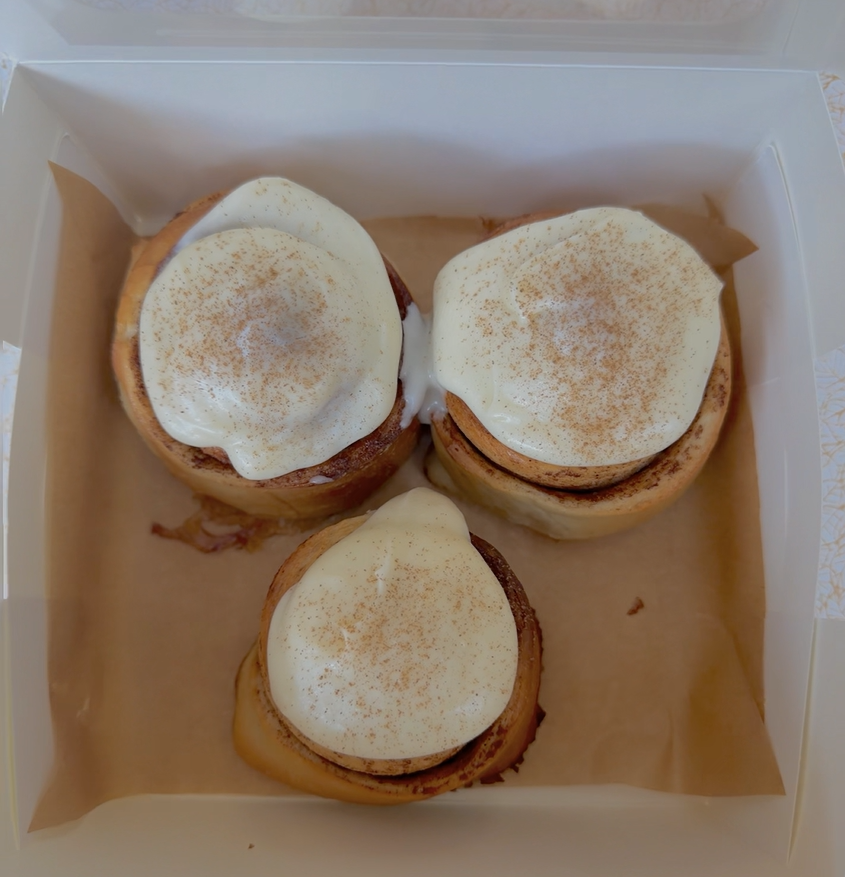
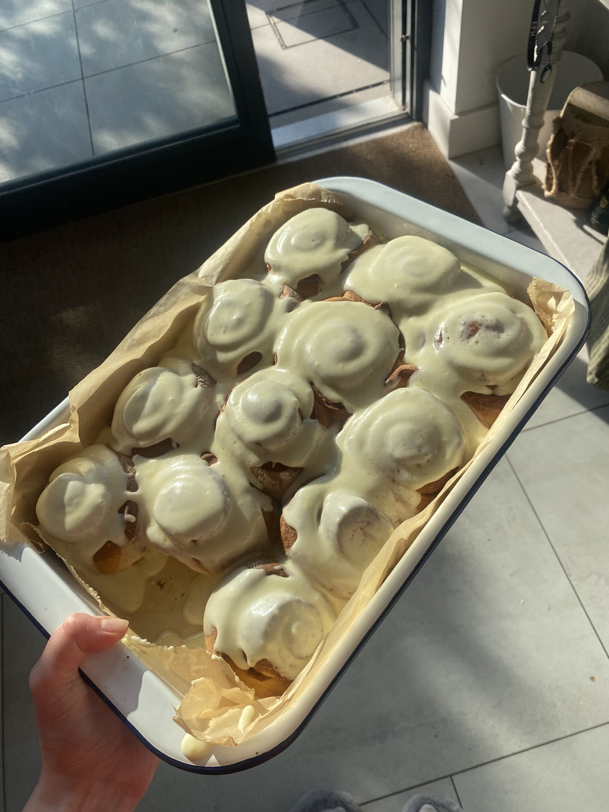
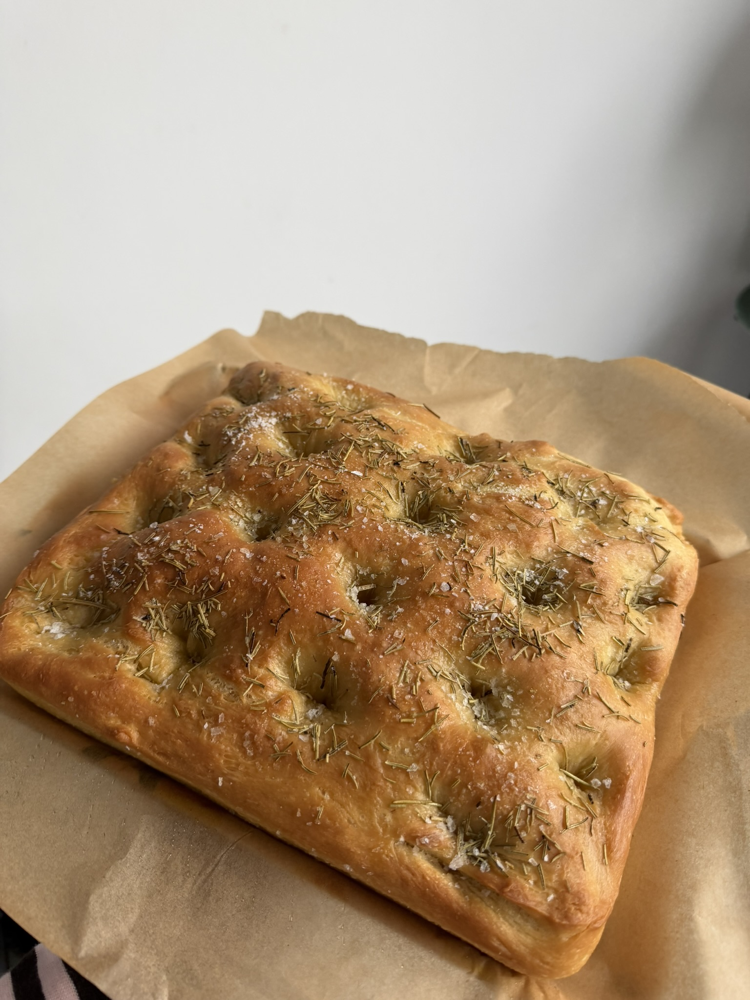
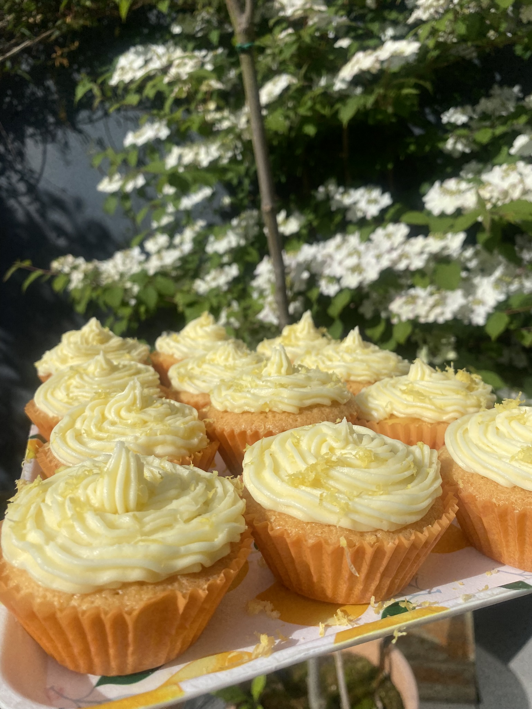
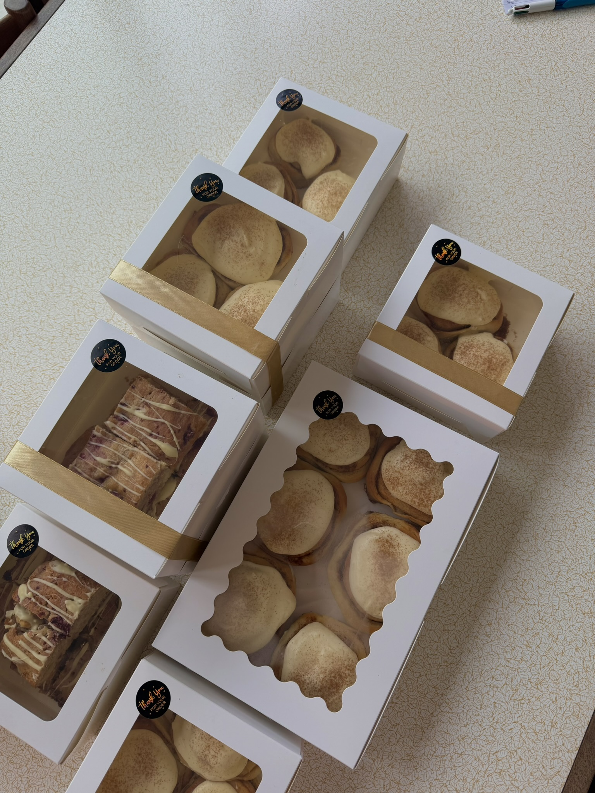
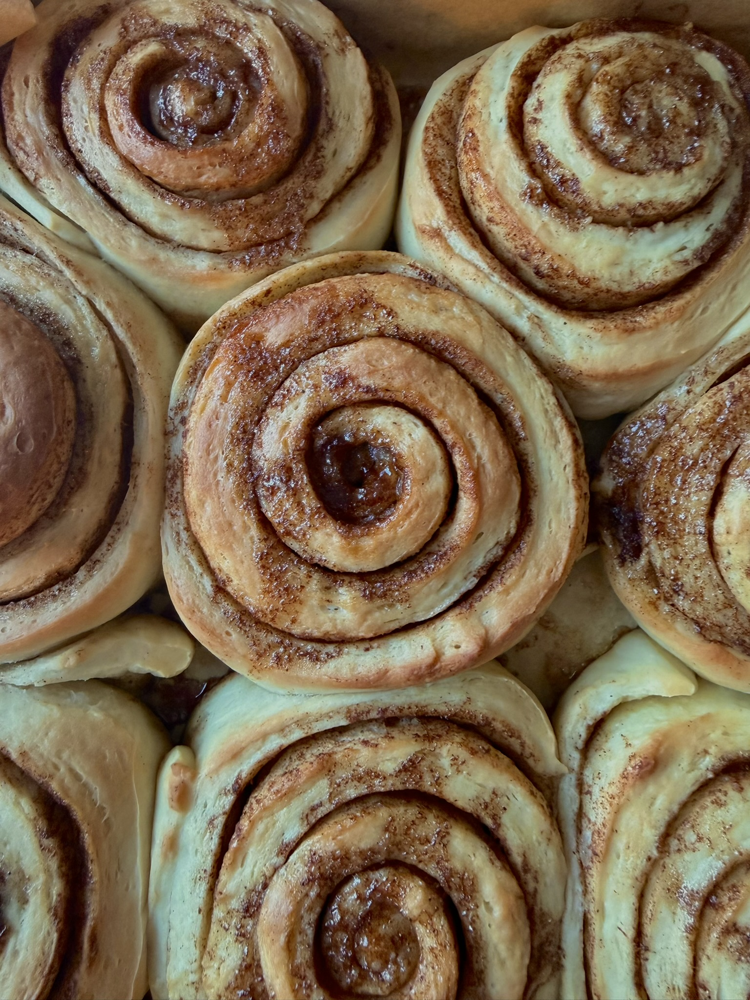

In order to raise money for Pieta, I solely managed and operated a month long bake sale, donating 60% of the profits to Pieta.
September is suicide awareness month, but I think this issue should be spoken about for more than just one month a year. That is why for the month of October I ran this bake sale.

It was a huge success. My customers were able to enjoy their variety of sweet treats and collectively we were able to make a difference.

```{=html}
  <div style="position:relative; max-width:400px; margin:auto; border-radius:10px; overflow:hidden; box-shadow:0 4px 10px rgba(0,0,0,0.15);">
  <div id="dogCarousel" style="display:flex; transition:transform 0.4s ease;">
    
    
    
    
    
    

  </div>
  <button onclick="moveCarousel(-1)" style="position:absolute; top:50%; left:10px; transform:translateY(-50%); background:rgba(0,0,0,0.4); color:white; border:none; border-radius:50%; width:36px; height:36px; font-size:18px; cursor:pointer;">&#8249;</button>
  <button onclick="moveCarousel(1)" style="position:absolute; top:50%; right:10px; transform:translateY(-50%); background:rgba(0,0,0,0.4); color:white; border:none; border-radius:50%; width:36px; height:36px; font-size:18px; cursor:pointer;">&#8250;</button>
  <div style="position:absolute; bottom:10px; width:100%; text-align:center;">
    <span onclick="goToSlide(0)" class="dot" style="display:inline-block; width:10px; height:10px; background:white; border-radius:50%; margin:3px; cursor:pointer; opacity:0.6;"></span>
    <span onclick="goToSlide(1)" class="dot" style="display:inline-block; width:10px; height:10px; background:white; border-radius:50%; margin:3px; cursor:pointer; opacity:0.6;"></span>
    <span onclick="goToSlide(2)" class="dot" style="display:inline-block; width:10px; height:10px; background:white; border-radius:50%; margin:3px; cursor:pointer; opacity:0.6;"></span>
    <span onclick="goToSlide(3)" class="dot" style="display:inline-block; width:10px; height:10px; background:white; border-radius:50%; margin:3px; cursor:pointer; opacity:0.6;"></span>
    <span onclick="goToSlide(4)" class="dot" style="display:inline-block; width:10px; height:10px; background:white; border-radius:50%; margin:3px; cursor:pointer; opacity:0.6;"></span>
    <span onclick="goToSlide(5)" class="dot" style="display:inline-block; width:10px; height:10px; background:white; border-radius:50%; margin:3px; cursor:pointer; opacity:0.6;"></span>
  </div>
</div>
<script>
let dogCurrent = 0;
const dogTotal = 6;
function moveCarousel(dir) {
  dogCurrent = (dogCurrent + dir + dogTotal) % dogTotal;
  updateCarousel();
}
function goToSlide(index) {
  dogCurrent = index;
  updateCarousel();
}
function updateCarousel() {
  document.getElementById('dogCarousel').style.transform = 'translateX(-' + (dogCurrent * 100) + '%)';
  document.querySelectorAll('.dot').forEach(function(dot, i) {
    dot.style.opacity = i === dogCurrent ? '1' : '0.6';
  });
}
</script>
```

I tracked my orders, stock, costing, and profits using a master excel file. Below is a sample of my masterfile[^1]. For privacy and security reasons I have removed some information such as email and phone number and have removed all formulas that link to the existing data sheet. 

```{=html}
<iframe src="https://docs.google.com/spreadsheets/d/e/2PACX-1vQ5fpVAdH40NugeLsV5ylhcWSrDw1kiQizGg7xIKahqOqKx82WaMHubIurej78JKAW5vcT3WXqG61Of/pubhtml?widget=true&amp;headers=false" style="width:100%; height:600px; border:0;"></iframe>
```
[Back to Projects](../index.qmd)


[^1]: Please note: This is a working document and is not up to date.