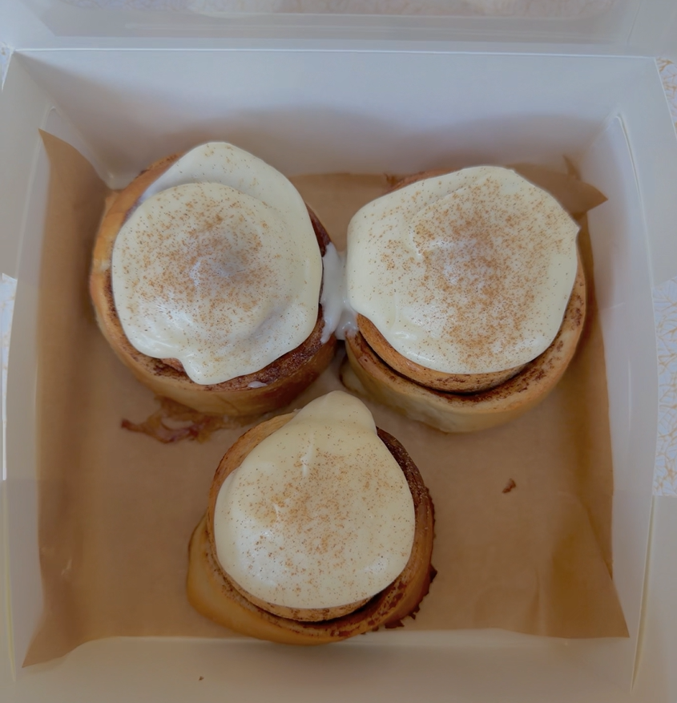
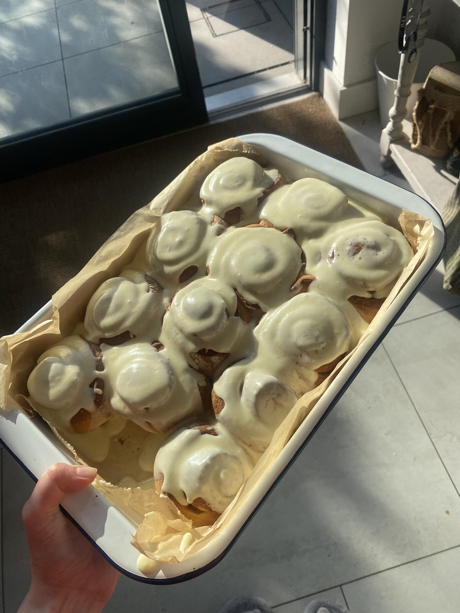
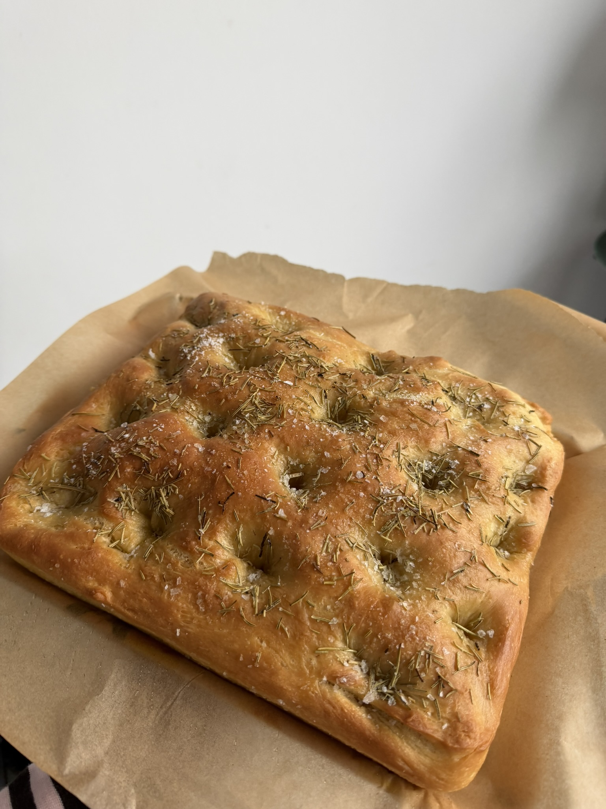
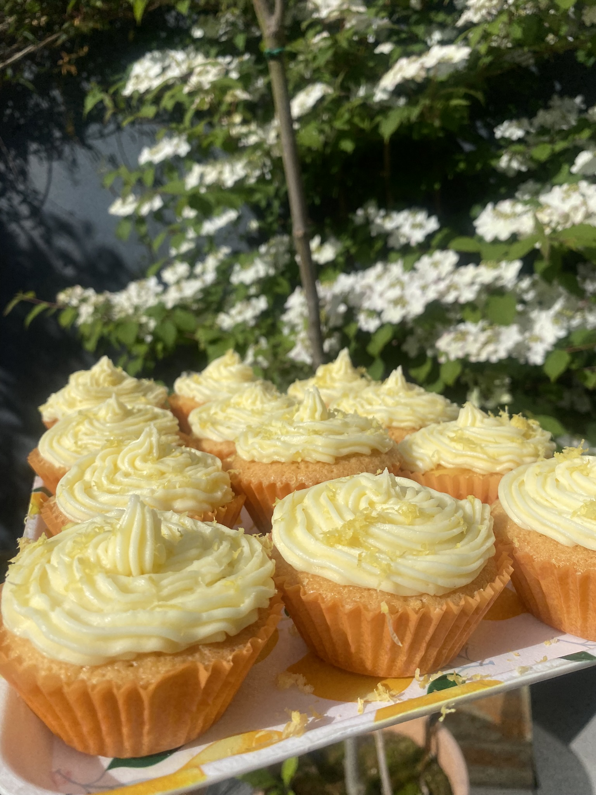
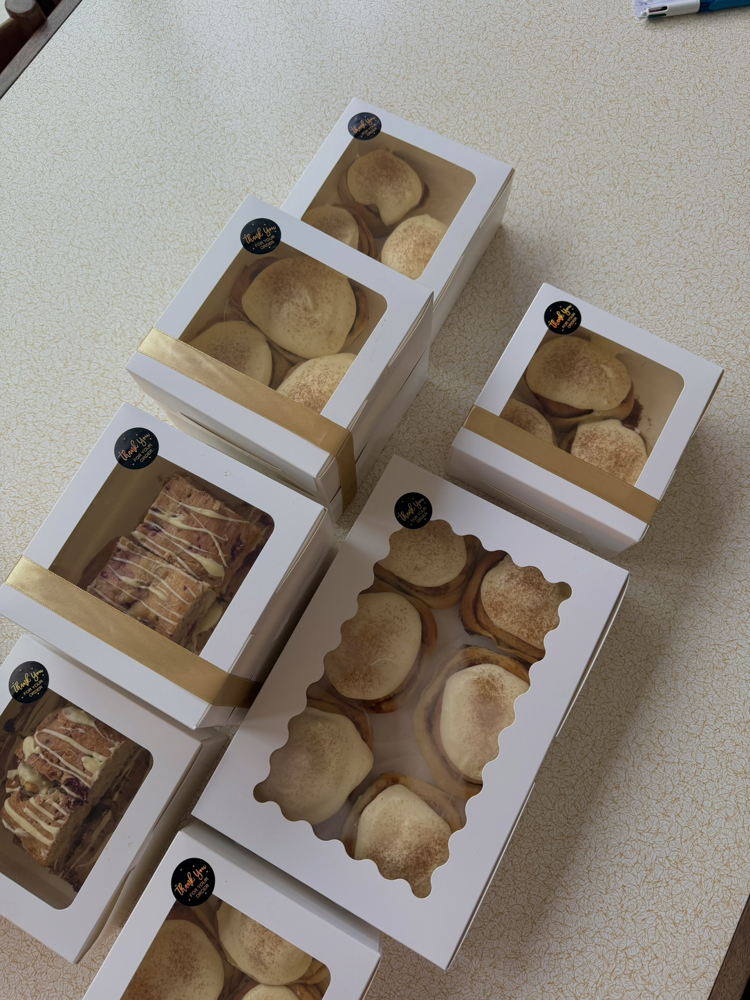
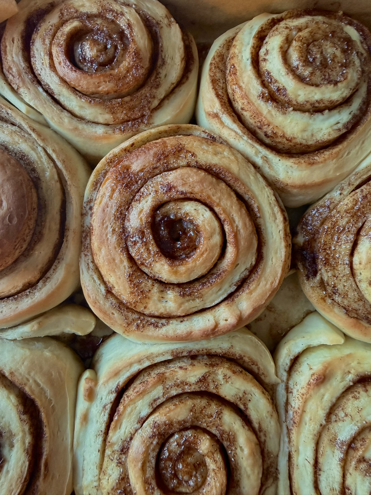

```{=html}
<link rel="stylesheet"
      href="https://cdnjs.cloudflare.com/ajax/libs/font-awesome/6.5.1/css/all.min.css">

<style>
  .insta-link {
    display: inline-flex;
    align-items: center;
    gap: 0.5rem;
    text-decoration: none;
    color: #E1306C;
    font-size: 1.2rem;
    font-weight: 600;
    margin-bottom: 1rem;
    transition: transform 0.2s;
  }
  .insta-link i {
    font-size: 2rem;
  }
  .insta-link:hover {
    transform: scale(1.05);
  }
</style>

<a class="insta-link"
   href="https://www.instagram.com/bakedby.cait/"
   target="_blank"
   rel="noopener noreferrer"
   aria-label="Follow bakedby.cait on Instagram">
  <i class="fa-brands fa-instagram"></i>
  <span>@bakedby.cait</span>
</a>
```

To raise money for Pieta, I independently organised and ran a month-long bake sale throughout October, donating **70% of the profits** to the charity.

Although September is recognised as Suicide Awareness Month, I believe suicide prevention and mental health awareness are issues that deserve attention all year round. This inspired me to run the fundraiser throughout October and encourage continued conversation and support.

I independently managed every aspect of the fundraiser, from planning and promoting the bake sale to **managing customer orders, preparing and baking all products, and tracking sales, expenses and donations**.

The fundraiser was a huge success. Customers enjoyed a variety of homemade treats, and together we were able to make a meaningful contribution to Pieta.

**In total, I raised €755.35 for Pieta.** Of this, €675.35 was raised through the bake sale and additional donations collected, with a further €80 donated directly through my iDonate fundraising page.

```{=html}
  <div style="position:relative; max-width:400px; margin:auto; border-radius:10px; overflow:hidden; box-shadow:0 4px 10px rgba(0,0,0,0.15);">
  <div id="dogCarousel" style="display:flex; transition:transform 0.4s ease;">
    
    
    
    
    
    

  </div>
  <button onclick="moveCarousel(-1)" style="position:absolute; top:50%; left:10px; transform:translateY(-50%); background:rgba(0,0,0,0.4); color:white; border:none; border-radius:50%; width:36px; height:36px; font-size:18px; cursor:pointer;">&#8249;</button>
  <button onclick="moveCarousel(1)" style="position:absolute; top:50%; right:10px; transform:translateY(-50%); background:rgba(0,0,0,0.4); color:white; border:none; border-radius:50%; width:36px; height:36px; font-size:18px; cursor:pointer;">&#8250;</button>
  <div style="position:absolute; bottom:10px; width:100%; text-align:center;">
    <span onclick="goToSlide(0)" class="dot" style="display:inline-block; width:10px; height:10px; background:white; border-radius:50%; margin:3px; cursor:pointer; opacity:0.6;"></span>
    <span onclick="goToSlide(1)" class="dot" style="display:inline-block; width:10px; height:10px; background:white; border-radius:50%; margin:3px; cursor:pointer; opacity:0.6;"></span>
    <span onclick="goToSlide(2)" class="dot" style="display:inline-block; width:10px; height:10px; background:white; border-radius:50%; margin:3px; cursor:pointer; opacity:0.6;"></span>
    <span onclick="goToSlide(3)" class="dot" style="display:inline-block; width:10px; height:10px; background:white; border-radius:50%; margin:3px; cursor:pointer; opacity:0.6;"></span>
    <span onclick="goToSlide(4)" class="dot" style="display:inline-block; width:10px; height:10px; background:white; border-radius:50%; margin:3px; cursor:pointer; opacity:0.6;"></span>
    <span onclick="goToSlide(5)" class="dot" style="display:inline-block; width:10px; height:10px; background:white; border-radius:50%; margin:3px; cursor:pointer; opacity:0.6;"></span>
  </div>
</div>
<script>
let dogCurrent = 0;
const dogTotal = 6;
function moveCarousel(dir) {
  dogCurrent = (dogCurrent + dir + dogTotal) % dogTotal;
  updateCarousel();
}
function goToSlide(index) {
  dogCurrent = index;
  updateCarousel();
}
function updateCarousel() {
  document.getElementById('dogCarousel').style.transform = 'translateX(-' + (dogCurrent * 100) + '%)';
  document.querySelectorAll('.dot').forEach(function(dot, i) {
    dot.style.opacity = i === dogCurrent ? '1' : '0.6';
  });
}
</script>
```

I tracked my orders, stock, costing, and profits using a master excel file. Below is a sample of my masterfile[^1]. For privacy and security reasons I have removed some information such as email and phone number and have removed all formulas that link to the existing data sheet. 

```{=html}
<iframe src="https://docs.google.com/spreadsheets/d/e/2PACX-1vQ5fpVAdH40NugeLsV5ylhcWSrDw1kiQizGg7xIKahqOqKx82WaMHubIurej78JKAW5vcT3WXqG61Of/pubhtml?widget=true&amp;headers=false" style="width:100%; height:600px; border:0;"></iframe>
```

[Back to Projects](../index.qmd)


[^1]: Please note: This is a working document and is not up to date.